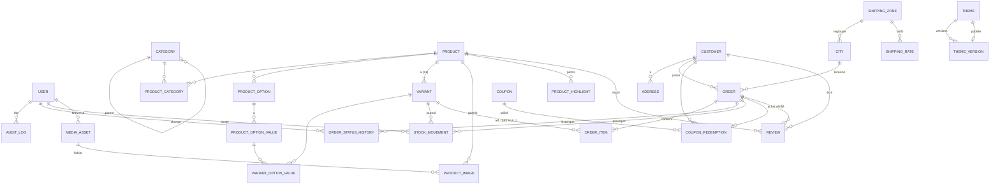

# Architecture — Plateforme e-commerce Ma Petite Corée.ma

> **Statut : PROPOSITION À VALIDER** — aucun code backend/admin n'est écrit.
> Base : branche `claude/relaxed-euler-ycano8`, commit `6c86992`, `docs/BACKEND.md` (contrat actuel).
> Marqueurs : **[DÉCISION]** = choix à valider · **[HYPOTHÈSE]** = non vérifié · **[DONNÉES MANQUANTES]** = info à fournir.

---

## 0. Constat de départ (inspection du dépôt)

| Élément | État actuel | Conséquence |
|---|---|---|
| Storefront | React 18 + Vite 5, react-router 6, CSS unique (`global.css`) | À **conserver tel quel** ; l'admin est ajouté à côté |
| Couche API front | `src/api/client.js` + `endpoints.js` : `/products`, `/products/:slug`, `/categories`, `/config`, `/promo-codes/validate`, `/orders` | Ces chemins deviennent `/api/v1/store/...` sans changer le front (`VITE_API_BASE_URL=/api/v1/store`) |
| Format produit | `id, slug, brand, name, displayName, cardLine, price, categories[], summary, highlights[{icon,label}], ingredients[], usage[], benefits[], skinTypes, stock, cardImage, mainImage, galleryImages[], sceneImage, hoverImage` ; Image = `{src, src640, alt, fit, position}` | Le backend **renvoie exactement ce format** (sérialiseur dédié) |
| Commande | Le front envoie `{customer, items:[{productId, qty}], promoCode, paymentMethod:'cod', deliveryMethod:'home'}` | Compatible ; on ajoute `variantId` **optionnel** |
| Accueil | Hero → **Le rituel** → Ingrédients → Bannière beauté → Produits du moment (carrousel) → Réassurance → Footer | Le registre de sections doit contenir **« Routine Steps »** (absent de la demande) |
| Tests | ESLint ; scripts Playwright hors dépôt | À intégrer au dépôt (`e2e/`) |

---

## 1. Remarques critiques avant de valider

1. **Coût / bénéfice** — Construire un « mini-Shopify » pour **5 produits** est un projet lourd (plusieurs mois de développement [HYPOTHÈSE]). Alternatives qui couvrent déjà 80 % du besoin :

   | Option | Pour | Contre |
   |---|---|---|
   | Shopify Basic | Admin, thème, commandes, stats prêts | Abonnement mensuel + design actuel à refaire en thème Liquid ; COD Maroc à vérifier [NON VÉRIFIÉ] |
   | YouCan (plateforme marocaine) | COD et livraison locale | Personnalisation limitée [NON VÉRIFIÉ] |
   | Saleor (Django, open source) | Backend e-commerce Django complet | GraphQL (pas DRF), lourd pour 1 boutique |
   | **Sur mesure (ta décision)** | Contrôle total, design conservé | Temps, maintenance, sécurité à ta charge |

   La décision est prise ; je la respecte, mais **l'ordre de livraison doit vendre d'abord** (commandes réelles) et ajouter l'éditeur de thème **en dernier** (le site est déjà beau aujourd'hui).
2. **« Theme sections » en table séparée** : déconseillé. Les sections vivent **dans le JSON versionné** du thème ; une table par instance de section rend la publication atomique et la restauration plus complexes sans bénéfice. Le registre des types de sections est **dans le code** (liste blanche). **[DÉCISION]**
3. **« React Admin Dashboard »** : si tu parles de la librairie `react-admin` → rapide pour du CRUD, mais rendu « Shopify premium » difficile. Recommandation : admin **sur mesure** avec TanStack Query/Table + React Hook Form + Zod + Recharts + dnd-kit + TipTap. **[DÉCISION]**
4. **Compétences manquantes probables** : hébergement/DevOps (MySQL, sauvegardes, HTTPS), juridique (mentions de facture marocaines : ICE, IF, RC — [À VÉRIFIER avec un comptable] ; loi 09-08/CNDP), photo/contenu produit.

---

## 2. Structure des dossiers

Le storefront **reste à la racine** (aucun déplacement de fichiers = aucun risque de casse). On ajoute `backend/`, `shared/` et `e2e/`.

```
store-produit-korea/
├── src/                         # React (storefront existant + admin)
│   ├── api/  services/  context/  components/  pages/  ...   (inchangés)
│   ├── theme/                   # NOUVEAU — rendu des sections (partagé storefront/éditeur)
│   │   ├── registry.js          # type → composant + schéma (liste blanche)
│   │   ├── SectionRenderer.jsx  # rend une liste de sections validées
│   │   ├── sections/            # HeroBanner, RoutineSteps, Ingredients, FeaturedProducts…
│   │   └── useTheme.js          # thème publié (API) ou défaut local
│   └── admin/                   # NOUVEAU — chargé en lazy sous /admin (n'alourdit pas la boutique)
│       ├── AdminApp.jsx  routes.jsx  layout/ (Sidebar, Topbar)
│       ├── api/                 # client admin (cookies + CSRF)
│       ├── auth/                # login, garde de routes, rôles
│       ├── components/          # DataTable, KpiCard, MediaPicker, RichTextEditor, StatusBadge…
│       └── pages/               # dashboard, products, orders, customers, inventory, categories,
│                                #  discounts, analytics, theme-editor, settings
├── shared/
│   └── theme-schemas/           # JSON Schema des sections (SOURCE UNIQUE, lue par Python ET React)
├── backend/
│   ├── manage.py  pyproject.toml  .env.example
│   ├── config/                  # settings/{base,dev,prod,test}.py, urls.py, wsgi/asgi
│   ├── apps/
│   │   ├── accounts/  catalog/  media_library/  inventory/  customers/
│   │   ├── orders/  promotions/  shipping/  reviews/  store_settings/
│   │   ├── themes/  analytics/  audit/
│   │   └── core/                # utilitaires : argent, téléphone, pagination, erreurs, permissions
│   └── tests/
├── e2e/                         # Playwright (scripts actuels formalisés)
├── docker-compose.yml           # dev : MySQL 8 + backend + Vite
└── docs/  ARCHITECTURE.md  BACKEND.md  API.md (généré OpenAPI)
```

---

## 3. Applications Django et responsabilités

| App | Responsabilité | Modèles |
|---|---|---|
| `accounts` | Utilisateurs admin (login par e-mail), rôles (Groups), 2FA optionnelle | `User` |
| `catalog` | Produits, options, variantes, images, catégories, SEO, statuts | `Category`, `Product`, `ProductCategory`, `ProductOption`, `ProductOptionValue`, `Variant`, `VariantOptionValue`, `ProductImage`, `ProductHighlight` |
| `media_library` | Upload validé, conversion WebP, déclinaisons 640/1200, stockage externe | `MediaAsset` |
| `inventory` | Stock par variante, journal des mouvements, alertes stock bas | `StockMovement` (+ `Variant.stock_quantity`) |
| `customers` | Clients invités (identifiés par téléphone), adresses, historique | `Customer`, `Address` |
| `orders` | Création COD transactionnelle, statuts, historique, factures, export Excel | `Order`, `OrderItem`, `OrderStatusHistory`, `OrderNumberSequence` |
| `promotions` | Codes promo, règles, utilisations | `Coupon`, `CouponRedemption` |
| `shipping` | Villes, zones, tarifs | `ShippingZone`, `City`, `ShippingRate` |
| `reviews` | Avis modérés (aucun faux avis) | `Review` |
| `store_settings` | Réglages boutique (singleton) | `StoreSettings` |
| `themes` | Thème, brouillon, versions publiées, publication atomique, restauration | `Theme`, `ThemeVersion` |
| `analytics` | Agrégats (CA, commandes, best-sellers…) — **pas de table**, requêtes SQL | — |
| `audit` | Journal des actions admin (append-only) | `AuditLog` |

Règle : la logique métier est dans des **services** (`apps/orders/services.py`…), pas dans les vues ni les sérialiseurs.

---

## 4. Modèle de données MySQL

Conventions : InnoDB, `utf8mb4_unicode_ci`, montants en **`DECIMAL(10,2)`** (jamais de float), devise unique MAD, dates en UTC (affichage `Africa/Casablanca`), `created_at`/`updated_at` partout.



### 4.1 Tables (champs clés, contraintes, index, suppression)

**accounts_user** — `id`, `email` UNIQUE, `password` (hash Argon2), `first_name`, `last_name`, `is_active`, `is_staff`, `last_login`. Rôles = `auth_group` (Owner, Admin, Order Manager, Content Editor, Analyst). Suppression : **désactiver**, jamais supprimer (traçabilité).

**catalog_category** — `id`, `slug` UNIQUE, `name`, `parent_id` FK→category **SET NULL**, `position`, `is_active`, `seo_title`, `seo_description`. Index (`is_active`, `position`).

**catalog_product** — `id`, `slug` UNIQUE, `brand`, `name`, `display_name`, `short_description` (= `cardLine`), `summary`, `description_html` (assaini), `ingredients` JSON (liste), `benefits` JSON, `usage_steps` JSON, `skin_types`, `status` ENUM(draft, active, archived) INDEX, `main_image_id` FK→product_image **SET NULL**, `hover_image_id` **SET NULL**, `scene_image_id` **SET NULL**, `seo_title`, `seo_description`, `og_image_id` FK→media **SET NULL**, `published_at`. Index (`status`, `published_at`). Suppression : **PROTECT si commandé** → on archive.
> Les listes `ingredients/benefits/usage_steps` en JSON : elles sont toujours lues/écrites en bloc avec le produit ; une table par ligne n'apporte rien. **[DÉCISION]**

**catalog_product_category** — (`product_id` CASCADE, `category_id` CASCADE, `position`), UNIQUE(product, category). Ordre conservé = 1re catégorie = catégorie principale (comme aujourd'hui).

**catalog_product_highlight** — `product_id` CASCADE, `icon` (liste blanche : droplets, leaf, sparkles, sun, citrus, eye, clock, layers, flask, hand), `label`, `position`.

**catalog_product_option** — `product_id` CASCADE, `name` (ex. « Contenance »), `position` ; UNIQUE(product, name) ; max 3 options.
**catalog_product_option_value** — `option_id` CASCADE, `value`, `position` ; UNIQUE(option, value).

**catalog_variant** — `id`, `product_id` **CASCADE** (bloqué de fait par PROTECT produit), `sku` UNIQUE NULL, `barcode` UNIQUE NULL, `price` DECIMAL, `compare_at_price` DECIMAL NULL, `cost` DECIMAL NULL (**jamais exposé publiquement**), `stock_quantity` INT, `track_inventory` BOOL, `allow_backorder` BOOL, `low_stock_threshold` INT, `weight_grams` NULL, `position`, `is_default`. CHECK `price >= 0`, CHECK `stock_quantity >= 0 OR allow_backorder`, CHECK `compare_at_price IS NULL OR compare_at_price > price`. Index (`product_id`, `position`), (`stock_quantity`).
> Chaque produit a **au moins une variante** (variante par défaut invisible si pas d'options). Le `price` public = prix de la variante par défaut → format actuel inchangé.

**catalog_variant_option_value** — (`variant_id` CASCADE, `option_value_id` **PROTECT**), UNIQUE(variant, option_value).

**catalog_product_image** — `product_id` CASCADE, `media_id` FK→media **PROTECT**, `alt`, `fit` ENUM(contain, cover), `focal_position` (ex. `50% 88%`, regex validée), `position`. UNIQUE(product, position) différé via réordonnancement transactionnel.

**media_library_mediaasset** — `id`, `storage_key` UNIQUE, `original_filename`, `mime` (image/webp|jpeg|png|avif), `width`, `height`, `bytes`, `sha256` UNIQUE (déduplication), `renditions` JSON (`{"640": key, "1200": key}`), `alt_default`, `uploaded_by_id` **SET NULL**, `deleted_at` (suppression douce). Suppression réelle interdite si référencé (produit ou thème publié/brouillon — vérifié par service).

**inventory_stockmovement** — `id`, `variant_id` **PROTECT**, `delta` INT (≠0), `reason` ENUM(order_placed, order_cancelled, order_returned, manual_adjustment, restock, initial), `order_id` FK **SET NULL**, `user_id` **SET NULL**, `note`, `quantity_after` INT, `created_at`. Index (`variant_id`, `created_at`). Append-only (jamais modifié).

**customers_customer** — `id`, `phone_e164` UNIQUE (ex. `+212612345678`), `full_name`, `email` NULL, `orders_count`, `total_spent` (dénormalisés, recalculés par service), `first_order_at`, `last_order_at`, `notes`, `anonymized_at`. Suppression : **anonymisation** (09-08), pas de DELETE si commandes.

**customers_address** — `customer_id` CASCADE, `full_name`, `phone_e164`, `city_id` FK **PROTECT**, `city_label`, `address_line`, `is_default`.

**orders_order** — `id`, `number` UNIQUE (ex. `MPC-2026-000123`), `customer_id` **PROTECT**, `status` ENUM(pending, confirmed, shipped, delivered, cancelled, returned) INDEX, `payment_method` ENUM(cod), `payment_status` ENUM(unpaid, paid, refunded), **snapshot livraison** : `ship_full_name`, `ship_phone`, `ship_city_id` FK **SET NULL**, `ship_city_label`, `ship_address`, montants : `subtotal`, `discount_total`, `shipping_fee`, `total` (DECIMAL), `coupon_code` (snapshot), `customer_note`, `ip_hash`, `user_agent`, `idempotency_key` UNIQUE, `placed_at` INDEX, `confirmed_at`, `shipped_at`, `delivered_at`, `cancelled_at`. Index (`status`, `placed_at`), (`customer_id`, `placed_at`). Suppression : **interdite** (PROTECT partout).

**orders_orderitem** — `order_id` CASCADE, `variant_id` **SET NULL**, snapshots : `product_name`, `variant_title`, `sku`, `unit_price`, `unit_cost` (pour la marge), `quantity` CHECK 1–20, `line_total`. Le produit peut changer de prix sans modifier l'historique.

**orders_orderstatushistory** — `order_id` CASCADE, `from_status`, `to_status`, `changed_by_id` **SET NULL** (NULL = client/système), `note`, `created_at`. Transitions autorisées codées dans une machine à états.

**orders_ordernumbersequence** — `year` PK, `last_value` (incrément sous `SELECT … FOR UPDATE`).

**promotions_coupon** — `code` UNIQUE (stocké en MAJUSCULES), `type` ENUM(percentage, fixed_amount, free_shipping), `value` DECIMAL, `min_subtotal` NULL, `starts_at`, `ends_at`, `usage_limit` NULL, `usage_limit_per_customer` NULL, `times_used`, `is_active`, `applies_to` ENUM(all, categories, products) + tables M2M `coupon_products` / `coupon_categories`. CHECK `value > 0`, CHECK pourcentage ≤ 100.
**promotions_couponredemption** — `coupon_id` **PROTECT**, `order_id` UNIQUE CASCADE, `customer_id` **PROTECT**, `amount`.

**shipping_shippingzone** — `name` UNIQUE, `is_active`. **shipping_city** — `name` UNIQUE, `zone_id` **PROTECT**, `is_active`, `position`. **shipping_shippingrate** — `zone_id` CASCADE, `fee` DECIMAL, `free_over_subtotal` NULL, `min_subtotal` NULL, `delivery_days_min/max`.
> Les villes actuelles de `store.js` deviennent la table `city` (migration de données).

**reviews_review** — `product_id` CASCADE, `customer_id` SET NULL, `order_id` SET NULL (`verified_purchase` calculé), `rating` CHECK 1–5, `title`, `body` (texte brut), `status` ENUM(pending, approved, rejected), `moderated_by_id` SET NULL. Index (`product_id`, `status`). **Seuls les avis approuvés sont publics ; aucun avis importé ou inventé.**

**store_settings_storesettings** — singleton (`id` = 1, CHECK), `brand_name`, `tagline`, `currency` = MAD, `whatsapp_number`, `contact_email`, `legal_name`, `ice`, `rc`, `if_number`, `address` (mentions facture), `show_demo_notices`, `max_qty_per_line` (20), `order_rate_limit`, `seo_default_title`, `seo_default_description`.

**themes_theme** — `id`, `name`, `draft_data` JSON, `draft_revision` INT (verrou optimiste), `draft_updated_by_id` SET NULL, `published_version_id` FK→theme_version **SET NULL**, `updated_at`. Un seul thème actif (boutique unique) ; la table permet d'en préparer un second plus tard.
**themes_themeversion** — `id`, `theme_id` **PROTECT**, `number` INT, UNIQUE(theme, number), `data` JSON (validé), `schema_version` INT, `checksum` (sha256 du JSON), `published_at`, `published_by_id` SET NULL, `note`, `restored_from_id` SET NULL. **Immuable** une fois créée.

**audit_auditlog** — `id`, `actor_id` SET NULL, `actor_email` (snapshot), `action` (ex. `product.update`, `order.status_change`, `theme.publish`, `auth.login_failed`), `target_type`, `target_id`, `changes` JSON (avant/après, **sans secrets ni mot de passe**), `ip`, `user_agent`, `created_at` INDEX. Append-only, index (`target_type`, `target_id`), (`actor_id`, `created_at`).

---

## 5. Règles serveur critiques

### 5.1 Création de commande (POST public) — dans **une transaction**
1. Valider le corps (DRF) : téléphone marocain → E.164, ville active, adresse ≥ 8 caractères, 1–20 lignes, qty 1–20, `paymentMethod = cod`.
2. Résoudre chaque ligne : `variantId` sinon variante par défaut du `productId` ; produit `active` obligatoire.
3. `SELECT … FOR UPDATE` sur les variantes concernées (ordre d'id croissant → pas d'interblocage).
4. Vérifier le stock (`track_inventory` et pas de backorder) → sinon **409** avec les lignes en défaut.
5. Recalculer **tous** les prix depuis la base, appliquer le coupon (verrouillé, limites vérifiées), calculer la livraison (zone de la ville).
6. Créer client (upsert par téléphone), commande, lignes (snapshots), historique `pending`, mouvements de stock (−qty), utilisation du coupon, numéro de commande.
7. Commit → réponse `{number, createdAt, totals}`. Les totaux envoyés par le client sont **ignorés**.
- **Idempotence** : en-tête `Idempotency-Key` (UUID généré par le front) → un double clic ne crée pas deux commandes.
- **Annulation / retour** : remise en stock (+qty) dans la même transaction que le changement de statut.

### 5.2 Anti-abus sur `POST /orders`
- Throttling DRF par IP (ex. 5/10 min) et par téléphone (ex. 3/heure) [valeurs à ajuster].
- Champ piège (honeypot) invisible ; refus silencieux si rempli.
- Option : Cloudflare Turnstile si spam constaté [HYPOTHÈSE : pas nécessaire au départ].
- Limite de taille du corps, CORS restreint au domaine, journalisation des refus.

### 5.3 Sécurité générale
- **Authentification admin : session Django + cookie `HttpOnly; Secure; SameSite=Lax` + jeton CSRF** (même domaine que la boutique). Pas de JWT en localStorage.
- Verrouillage après échecs (django-axes), mots de passe Argon2, 2FA TOTP recommandée pour Owner (django-otp) **[DÉCISION]**.
- Permissions par rôle sur **chaque** vue admin (classe `HasRolePermission`) + tests de matrice.
- Uploads : liste blanche MIME **vérifiée par le contenu** (Pillow), taille ≤ 10 Mo, dimensions ≤ 6000 px, ré-encodage WebP (supprime EXIF/GPS et tout contenu caché), SVG **refusé**.
- Texte riche : HTML assaini côté serveur (nh3, liste blanche de balises : p, h2, h3, strong, em, ul, ol, li, a[href https/relatif]).
- Secrets uniquement en variables d'environnement (`DJANGO_SECRET_KEY`, `DATABASE_URL`, clés de stockage) ; `.env` ignoré ; `DEBUG=False` en production ; en-têtes HSTS, CSP, X-Frame-Options (sauf preview, voir §8).
- Audit : toute écriture admin (produit, prix, stock, commande, coupon, thème, réglages, rôles) + connexions.

---

## 6. API REST `/api/v1/`

Format commun : JSON, erreurs `{"error": {"code": "validation_error", "message": "...", "fields": {...}}}`, pagination `?page=&page_size=` (max 100) → `{items, page, pageSize, total}`, tri `?ordering=`, filtres explicites. Documentation OpenAPI générée (drf-spectacular) → `docs/API.md` + `/api/v1/schema/` (admin seulement en prod).

### 6.1 Public — `/api/v1/store/` (compatibles avec `src/api/endpoints.js`)

| Méthode | Route | Rôle | Notes |
|---|---|---|---|
| GET | `/products` | Liste des produits **actifs** | Format actuel exact (`{items:[Product]}`) + `variants[]`, `compareAtPrice` ajoutés (champs en plus = compatible) |
| GET | `/products/{slug}` | Fiche | 404 si brouillon/archivé |
| GET | `/categories` | Catégories actives | `{items:[{id, label}]}` (`id` = slug) |
| GET | `/config` | Config publique | `deliveryFee, freeDeliveryThreshold, whatsappNumber, cities[]` — **sans coupons** |
| POST | `/promo-codes/validate` | Vérifie un code pour un panier | Corps `{code, items}` → `{valid, discount, message}` ; throttlé |
| POST | `/orders` | Créer une commande COD | §5.1 ; throttlé ; `Idempotency-Key` |
| GET | `/theme` | Thème **publié** | Cache HTTP + ETag (checksum) |
| GET | `/products/{slug}/reviews` | Avis approuvés | Paginé |

Pas d'endpoint public de suivi de commande au départ (données personnelles) — le suivi reste via WhatsApp. **[DÉCISION]**

### 6.2 Admin — `/api/v1/admin/` (session + CSRF obligatoires)

Rôles : **O**wner · **A**dmin · **M** Order Manager · **E** Content Editor · **N** Analyst (lecture seule).

| Domaine | Routes | Permissions |
|---|---|---|
| Auth | `GET /auth/csrf`, `POST /auth/login`, `POST /auth/logout`, `GET /auth/me`, `POST /auth/password` | public (login throttlé) / connecté |
| Utilisateurs | `GET/POST /users`, `GET/PATCH /users/{id}` (désactivation, rôle) | O |
| Produits | `GET/POST /products`, `GET/PATCH/DELETE /products/{id}`, `POST /products/{id}/duplicate`, `POST /products/{id}/status` | lecture O A M E N ; écriture O A E ; `cost` visible O A N |
| Variantes | `GET/POST /products/{id}/variants`, `PATCH/DELETE /variants/{id}`, `POST /products/{id}/variants/generate` | O A E |
| Images produit | `POST /products/{id}/images`, `PATCH /product-images/{id}`, `POST /products/{id}/images/reorder`, `DELETE /product-images/{id}` | O A E |
| Médias | `GET/POST /media` (multipart), `PATCH/DELETE /media/{id}` | O A E |
| Catégories | `GET/POST /categories`, `PATCH/DELETE /categories/{id}`, `POST /categories/reorder` | O A E |
| Stock | `GET /inventory` (filtres stock bas), `POST /inventory/adjust` `{variantId, delta, reason, note}`, `GET /inventory/movements` | lecture O A M N ; ajustement O A M |
| Commandes | `GET /orders` (filtres statut, dates, ville, recherche n°/tél.), `GET /orders/{id}`, `POST /orders/{id}/status` `{to, note}`, `PATCH /orders/{id}` (adresse, note interne), `GET /orders/{id}/invoice` (HTML imprimable), `GET /orders/export.xlsx` | O A M ; N lecture |
| Clients | `GET /customers`, `GET /customers/{id}` (+ commandes), `PATCH /customers/{id}`, `POST /customers/{id}/anonymize` | O A M ; anonymiser : O |
| Promotions | `GET/POST /coupons`, `GET/PATCH/DELETE /coupons/{id}` | O A |
| Livraison | `GET/POST /shipping/zones`, `PATCH /shipping/zones/{id}`, `GET/POST/PATCH /shipping/cities`, `/shipping/rates` | O A |
| Avis | `GET /reviews`, `POST /reviews/{id}/moderate` | O A E |
| Thème | `GET /theme/draft`, `PUT /theme/draft` (`If-Match: revision`), `POST /theme/publish`, `GET /theme/versions`, `GET /theme/versions/{id}`, `POST /theme/versions/{id}/restore`, `GET /theme/schema` | lecture O A E ; publier O A E **[DÉCISION : E peut publier ?]** |
| Réglages | `GET/PATCH /settings` | O A |
| Analytics | `GET /analytics/summary?from&to`, `/analytics/revenue?from&to&interval=day|week|month`, `/analytics/top-products`, `/analytics/customers`, `/analytics/low-stock` | O A N ; M : commandes seulement |
| Audit | `GET /audit-logs` | O |

---

## 7. Admin Dashboard (React)

- Chargé en **lazy** sous `/admin/*` : le bundle de la boutique ne grossit pas (vérifié par un test de taille).
- Garde de route : `GET /auth/me` → redirection `/admin/login` ; menus et boutons masqués selon le rôle (le serveur reste l'autorité).
- Design : sobre « Shopify-like » (barre latérale fixe, fond clair, cartes), avec les couleurs/typo de la marque ; responsive (tablette OK, mobile = consultation et commandes).

| Page | Contenu principal |
|---|---|
| `/admin/login` | E-mail, mot de passe, (2FA), message d'erreur générique |
| `/admin/dashboard` | Sélecteur de période ; KPI : CA, commandes, panier moyen, taux d'annulation/retour, nouveaux clients ; courbe CA ; commandes par statut ; top produits ; alertes stock bas ; 10 dernières commandes |
| `/admin/products` | Tableau (image, nom, statut, stock, prix, catégorie), recherche, filtres, actions groupées (activer/archiver) |
| `/admin/products/new`, `/:id` | Product Builder (§8) |
| `/admin/orders` | Tableau filtrable (statut, dates, ville), recherche n°/téléphone, export Excel |
| `/admin/orders/:id` | Lignes, totaux, client, adresse, timeline des statuts, boutons de transition, note interne, facture imprimable, lien WhatsApp client |
| `/admin/customers` (+ `/:id`) | Liste, nb commandes, total dépensé ; fiche avec historique d'achats et adresses |
| `/admin/inventory` | Stock par variante, seuils, ajustement avec motif, journal des mouvements |
| `/admin/categories` | Liste ordonnable (glisser-déposer), SEO |
| `/admin/discounts` | Coupons : type, valeur, dates, limites, utilisations |
| `/admin/analytics` | Rapports détaillés + export |
| `/admin/theme-editor` | Éditeur visuel (§9) |
| `/admin/settings` | Boutique, mentions légales facture, livraison (zones/villes/tarifs), utilisateurs & rôles, journal d'audit |

---

## 8. Product Builder — parcours

1. **Créer** → produit en `draft` avec une variante par défaut ; slug auto (modifiable, unicité vérifiée en direct).
2. Formulaire en cartes (colonne principale + colonne latérale, comme Shopify) :
   - **Infos** : nom, marque, nom affiché, description courte (≤ 120 car.), description riche (TipTap → HTML assaini).
   - **Médias** : glisser-déposer multi-fichiers → upload `/media` (barre de progression, aperçus) → réordonner (dnd-kit) → choisir **image principale**, **image de survol**, **image « scène »**, `fit` et point focal (aperçu carte/fiche en direct).
   - **Prix** : prix, prix barré, coût → marge et % calculés en direct.
   - **Stock** : SKU, code-barres, suivi du stock, quantité, seuil d'alerte, vente sans stock.
   - **Variantes** : jusqu'à 3 options → génération des combinaisons → tableau éditable (prix, stock, SKU par ligne).
   - **Contenu soin** : ingrédients, bienfaits, étapes d'utilisation (listes réordonnables), types de peau, pictos (icônes de la liste blanche).
   - **SEO** : titre, méta-description (compteurs), aperçu Google, image de partage.
   - **Colonne latérale** : statut, catégories (1re = principale), aperçu de la carte produit **avec les vrais composants du storefront**.
3. **Validation** : Zod côté client (retour immédiat) + DRF côté serveur (autorité). Passage en `active` refusé si : pas de prix, pas d'image principale, pas de catégorie, description vide → liste de contrôle affichée.
4. **Enregistrement** : bouton explicite + avertissement « modifications non enregistrées » ; verrou optimiste (`updated_at`) pour éviter d'écraser le travail d'un collègue.
5. Actions : dupliquer, archiver (jamais supprimer un produit déjà commandé), voir sur la boutique.

---

## 9. Visual Theme Builder

### 9.1 Principe
Le storefront **ne lit plus une page d'accueil codée en dur** mais une **liste de sections validées** rendues par `SectionRenderer`. Les sections sont des composants React **existants refactorés** (même HTML/CSS) qui reçoivent leurs réglages en props.

**Étape 0 obligatoire** : créer le thème par défaut (`shared/default-theme.json`) qui reproduit l'accueil actuel **à l'identique**, et prouver par le test DOM avant/après (déjà utilisé lors du nettoyage) que le rendu ne change pas. Sans API, le storefront utilise ce thème par défaut.

### 9.2 Interface
```
┌──────────────────────────────────────────────────────────────────────┐
│ ← Quitter   Accueil ▾   [🖥 Desktop][▭ Tablette][📱 Mobile]  ↶ ↷   Enregistré · [Enregistrer brouillon] [Publier] │
├──────────────┬───────────────────────────────────────┬───────────────┤
│ SECTIONS     │                                       │ RÉGLAGES      │
│ ▸ Header     │      <iframe> aperçu isolé            │ Hero Banner   │
│ ⋮ Hero ●     │      (/__preview, largeur 1280/       │ Titre  [...]  │
│ ⋮ Rituel     │       820/390 px)                     │ Image  [⇪]    │
│ ⋮ Ingrédients│      clic sur une section =           │ Bouton [...]  │
│ ⋮ Bannière   │      sélection à droite               │ Desktop|Mobile│
│ ⋮ Produits   │                                       │ Espacement ▭  │
│ + Ajouter    │                                       │ Fond   ■      │
│ ▸ Footer     │                                       │ 🗑 Supprimer   │
└──────────────┴───────────────────────────────────────┴───────────────┘
```
- Gauche : arbre sections → blocs ; glisser-déposer (dnd-kit) ; masquer/afficher ; dupliquer ; « + Ajouter » ouvre la bibliothèque (liste blanche).
- Centre : **iframe** sur la route `/__preview` du même front ; l'éditeur envoie le brouillon par `postMessage` (origine vérifiée) → rendu instantané sans enregistrer. Le storefront publié n'est jamais touché.
- Droite : formulaire **généré à partir du schéma** de la section (aucun formulaire écrit à la main par section).
- Annuler/rétablir (historique local), sauvegarde automatique du brouillon (debounce 2 s) + bouton explicite.

### 9.3 Format JSON du thème (stocké dans `draft_data` / `theme_version.data`)
```json
{
  "schemaVersion": 1,
  "settings": {
    "colors": { "primary": "#1F4D3A", "background": "#FAF6EF", "text": "#1E2A24", "accent": "#C9A27A" },
    "typography": { "headingFont": "cormorant", "bodyFont": "dm-sans", "baseSize": { "desktop": 16, "mobile": 15 } },
    "radius": "lg"
  },
  "templates": {
    "home": {
      "order": ["hero-1", "routine-1", "ingredients-1", "banner-1", "featured-1", "trust-1"],
      "sections": {
        "hero-1": {
          "type": "hero_banner",
          "disabled": false,
          "settings": {
            "eyebrow": "KOREAN & NATURAL SKINCARE",
            "heading": "LA BEAUTÉ AU NATUREL",
            "image": { "mediaId": 12 },
            "imageMobile": { "mediaId": 13 },
            "alignment": { "desktop": "left", "mobile": "center" },
            "paddingTop": { "desktop": 64, "mobile": 32 },
            "background": { "type": "color", "color": "#FAF6EF" }
          },
          "blocks": {
            "btn-1": { "type": "button", "settings": { "label": "Découvrir", "link": { "type": "internal", "path": "/produits" }, "style": "primary" } }
          },
          "blockOrder": ["btn-1"]
        }
      }
    }
  },
  "header": { "type": "header", "settings": {} },
  "footer": { "type": "footer", "settings": {}, "blocks": {}, "blockOrder": [] }
}
```
Les valeurs de couleur/typo deviennent des **variables CSS** (`--color-primary`…) — on réutilise le système de variables de `global.css`, aucune CSS libre.

### 9.4 Schéma d'une section (`shared/theme-schemas/hero_banner.json`, format JSON Schema + méta UI)
```json
{
  "type": "hero_banner",
  "name": "Hero Banner",
  "maxPerTemplate": 1,
  "settings": [
    { "id": "eyebrow", "type": "text", "label": "Sur-titre", "maxLength": 60, "default": "" },
    { "id": "heading", "type": "text", "label": "Titre", "maxLength": 80, "required": true, "default": "LA BEAUTÉ AU NATUREL" },
    { "id": "text", "type": "textarea", "label": "Texte", "maxLength": 240 },
    { "id": "image", "type": "image", "label": "Image desktop", "required": true },
    { "id": "imageMobile", "type": "image", "label": "Image mobile" },
    { "id": "alignment", "type": "select", "responsive": true, "options": ["left", "center"], "default": { "desktop": "left", "mobile": "center" } },
    { "id": "paddingTop", "type": "range", "responsive": true, "min": 0, "max": 160, "step": 8, "unit": "px", "default": { "desktop": 64, "mobile": 32 } },
    { "id": "background", "type": "background", "allow": ["color", "image"] }
  ],
  "blocks": [
    { "type": "button", "limit": 2, "settings": [
      { "id": "label", "type": "text", "maxLength": 30, "required": true },
      { "id": "link", "type": "link" },
      { "id": "style", "type": "select", "options": ["primary", "outline"], "default": "primary" }
    ] }
  ]
}
```
**Types de réglages autorisés (liste blanche)** : `text`, `textarea`, `richtext` (même assainissement que les produits), `number`, `range`, `checkbox`, `select`, `color` (regex `#RRGGBB`), `image` (référence `mediaId` existant uniquement), `link` (interne `/…` ou `https://` ; `javascript:`/`data:` refusés), `product`, `product_list` (ids, max 12), `category`, `icon` (liste blanche), `background`, `font` (liste fermée de polices auto-hébergées). `responsive: true` ⇒ valeur `{desktop, mobile}`.

### 9.5 Registre initial des sections

| Type | Rôle | Existe déjà ? |
|---|---|---|
| `hero_banner` | Hero image + texte + boutons | Oui (HomePage) |
| `routine_steps` | **Le rituel** en étapes liées à des produits | Oui (RitualSection) — **ajouté** |
| `ingredients` | Ingrédients en arches | Oui (IngredientsSection) |
| `promo_banner` | Bannière promotionnelle | Oui (BeautyBanner) |
| `featured_products` | Carrousel « produits du moment » | Oui (ProductCarousel) |
| `trust_badges` | Réassurance | Oui (Reassurance) |
| `footer` | Pied de page | Oui (SiteFooter) |
| `product_grid` | Grille filtrable | Oui (ProductGrid) |
| `best_sellers` | Produits les plus vendus (calcul serveur) | Nouveau |
| `image_with_text` | Image + texte | Nouveau |
| `rich_text` | Texte riche | Nouveau |
| `testimonials` | **Avis réels approuvés uniquement** (sinon section masquée) | Nouveau |
| `newsletter` | Inscription — **[DONNÉES MANQUANTES]** outil d'e-mailing ; sans outil, la section n'est pas activable | Nouveau |

### 9.6 Validation, versions, publication
- Validation **identique des deux côtés** depuis `shared/theme-schemas/` : React (avant envoi, messages clairs) et Django (`jsonschema` + règles maison : `type` dans la liste blanche, ids d'images/produits existants, taille JSON ≤ 256 Ko, max 30 sections).
- Aucun HTML/JS arbitraire : le rendu se fait **uniquement** via les composants enregistrés ; les textes sont rendus en texte (échappés par React) ; le richtext passe par l'assainisseur.
- **Brouillon** : `PUT /theme/draft` avec `If-Match: <revision>` → 409 si un autre admin a modifié entre-temps.
- **Publier** (transaction unique) : verrouiller le thème → valider le brouillon → créer `ThemeVersion(number+1, data, checksum)` → `theme.published_version = version` → audit → commit. Le storefront voit l'ancienne **ou** la nouvelle version, jamais un mélange.
- **Restaurer** : copie d'une version vers le brouillon (puis publier) — l'historique n'est jamais réécrit.
- **Performance** : `GET /store/theme` mis en cache (ETag/checksum, `Cache-Control` court + invalidation à la publication) ; le storefront garde le thème par défaut intégré comme repli si l'API ne répond pas.
- **Aperçu isolé** : route `/__preview` accessible seulement si session admin ; `X-Frame-Options: SAMEORIGIN` pour cette route ; `noindex`.

---

## 10. Plan de réalisation

Ordre choisi pour **vendre le plus tôt possible**. Durées non estimées tant que la disponibilité et l'hébergement ne sont pas connus [DONNÉES MANQUANTES].

| Phase | Contenu | Livrable vérifiable |
|---|---|---|
| **0. Fondations** | `backend/` Django + DRF + MySQL (docker-compose), settings par environnement, User + rôles, audit, format d'erreurs, CI (lint + tests) | `pytest` vert, `/api/v1/health` |
| **1. Catalogue** | catalog, media_library (stockage S3-compatible), shipping, store_settings, API publique compatible ; import des 5 produits actuels | Front avec `VITE_API_BASE_URL` : **DOM identique** au mode local |
| **2. Commandes réelles** | orders (transaction, stock, coupons, idempotence, anti-abus), customers | Vraie commande COD créée ; tests de concurrence (2 commandes pour le dernier article) |
| **3. Admin cœur** | Login, layout, Commandes (liste, détail, statuts, facture, Excel), Clients, Stock | Gestion quotidienne possible sans toucher au code |
| **4. Product Builder** | Produits, variantes, médias, catégories, SEO, coupons | Créer un produit de A à Z depuis l'admin |
| **5. Dashboard & analytics** | KPI, graphiques, filtres de dates, stock bas | Chiffres = requêtes SQL vérifiées à la main sur un jeu de test |
| **6. Theme Builder** | Étape 0 (accueil = sections, DOM identique) → éditeur → versions | Publier/restaurer sans casser la boutique |
| **7. Finitions** | Avis modérés, newsletter (si outil), 2FA, sauvegardes, mise en production | Checklist sécurité OWASP passée |

## 11. Stratégie de tests

| Niveau | Outils | Ce qui est testé |
|---|---|---|
| Backend unitaire | pytest-django, factory_boy | Calcul des totaux, coupons, transitions de statut, téléphone, validation de thème |
| Backend intégration | pytest + MySQL réel (docker) | Transactions, `SELECT FOR UPDATE`, **commandes concurrentes**, contraintes |
| Permissions | Test paramétré **rôle × endpoint** | Chaque rôle obtient 200/403 attendu ; anonyme → 401/403 |
| Sécurité | Tests dédiés | Upload piégé (faux PNG, SVG, image géante), HTML malveillant, lien `javascript:`, CSRF absent, throttling |
| Contrat API | OpenAPI (drf-spectacular) + test front | Le format renvoyé = format attendu par `src/services/` |
| Front | Vitest + Testing Library | Formulaires admin, générateur de formulaire depuis schéma, rendu des sections |
| E2E | Playwright (`e2e/`, dans le dépôt) | Parcours boutique (scripts actuels), commande réelle, admin (créer produit → visible en boutique), éditeur (modifier → publier → restaurer) ; largeurs 360/390/430/768/1366 |
| Non-régression visuelle | Comparaison DOM avant/après | Storefront inchangé à chaque phase |

---

## 12. Décisions attendues

1. Admin **sur mesure** (recommandé) ou librairie `react-admin` ?
2. Hébergement + stockage médias (ex. VPS + MySQL managé + Cloudflare R2/S3) — [DONNÉES MANQUANTES].
3. Le rôle « Content Editor » peut-il **publier** le thème, ou seulement préparer un brouillon ?
4. Sections `routine_steps` ajoutée et table « theme sections » remplacée par le JSON versionné : OK ?

## 13. Journal des décisions

| Date | Décision | Pourquoi | Action suivante | Échéance |
|---|---|---|---|---|
| 30/10/2026 | Django + DRF + MySQL, boutique unique, admin dans l'app React | Choix de l'utilisatrice | Valider ce document | [À définir] |
| 30/10/2026 | (proposé) Storefront à la racine, `backend/` à côté | Zéro déplacement = zéro casse | — | — |
| 30/10/2026 | (proposé) Sessions + CSRF, pas de JWT | Même domaine, plus sûr | — | — |
| 30/10/2026 | (proposé) Thème en JSON versionné, sections en liste blanche | Publication atomique, pas de code arbitraire | — | — |
